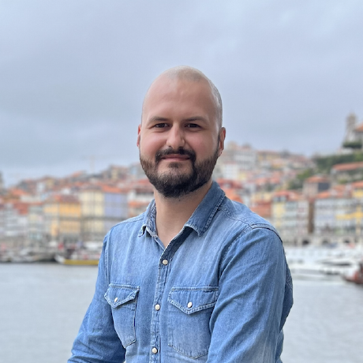
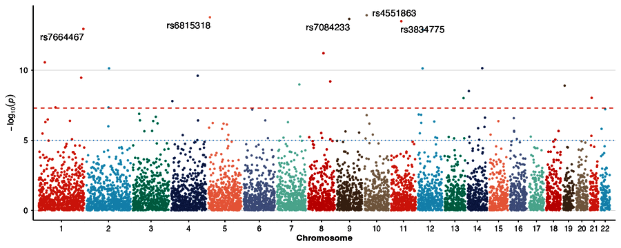
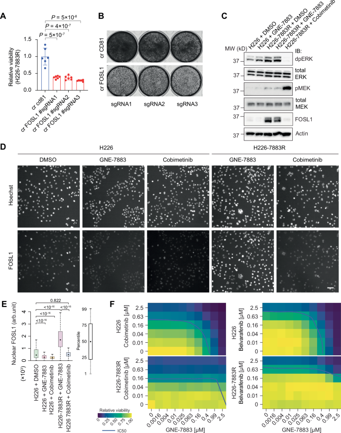
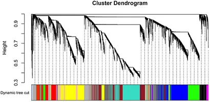

```{=html}
<section class="pf-hero2">
  <div class="pf-hero2-art" aria-hidden="true"></div>
  <div class="pf-hero2-inner">
    
    <div class="pf-hero2-text">
      <p class="pf-eyebrow">Bioinformatics · Computational biology · Biostatistics</p>
      <h1 class="pf-name">Bartosz Czech, PhD, Eng.</h1>
      <p class="pf-role">Bioinformatician and computational biologist</p>
      <p class="pf-role-2">Assistant Professor at Wrocław University of Environmental and Life Sciences · Senior Bioinformatician in pharmaceutical R&amp;D · Founder of GeneStat</p>
      <p class="pf-loc"><i class="bi bi-geo-alt"></i> Wrocław, Poland</p>
      <div class="pf-links">
        <a class="pf-btn pf-primary" href="cv.html"><i class="bi bi-file-earmark-person"></i> CV</a>
        <a class="pf-btn" href="mailto:bartosz.w.czech@gmail.com"><i class="bi bi-envelope"></i> Email</a>
        <a class="pf-btn" href="https://github.com/bczech"><i class="bi bi-github"></i> GitHub</a>
        <a class="pf-btn" href="https://scholar.google.com/citations?user=JYaz528AAAAJ&amp;hl=en"><i class="bi bi-mortarboard"></i> Google Scholar</a>
        <a class="pf-btn" href="https://orcid.org/0000-0002-9908-3007"><i class="bi bi-person-badge"></i> ORCID</a>
        <a class="pf-btn" href="https://www.linkedin.com/in/bczech"><i class="bi bi-linkedin"></i> LinkedIn</a>
      </div>
    </div>
  </div>
</section>
```

::: {.pf-stats}
::: {.pf-stat}
**** [peer-reviewed articles]{}
:::
::: {.pf-stat}
**** [citations]{}
:::
::: {.pf-stat}
**** [h-index]{}
:::
::: {.pf-stat}
**7** [years in pharma R&D]{}
:::
:::
[Citation counts from , updated . Google Scholar counts are usually higher.]{.pf-note}

## About

I am a bioinformatician and computational biologist. I analyse sequencing, mass spectrometry and drug screening data, build statistical models that answer biological questions, and write R packages and pipelines that make these analyses repeatable. My methods do not depend on the organism: I have worked with data from human cancer cell lines, cattle, chickens, cats, dog cells infected with influenza virus, and gut bacteria.

## Current roles

::: {.pf-grid}
::: {.pf-card}
[<i class="bi bi-bank"></i>]{.pf-card-ic}
[Since May 2026]{.pf-kicker}

### Assistant Professor

Department of Genetics, Wrocław University of Environmental and Life Sciences. Research in bioinformatics and computational biology; teaching bioinformatics and biostatistics.
:::

::: {.pf-card}
[<i class="bi bi-capsule-pill"></i>]{.pf-card-ic}
[Since July 2019]{.pf-kicker}

### Senior Bioinformatician

Pharmaceutical R&D, contracted through 7N. Drug response screens, NGS and phosphoproteomics data, R/Shiny applications and WDL pipelines.
:::

::: {.pf-card}
[<i class="bi bi-briefcase"></i>]{.pf-card-ic}
[Since 2019 · own company]{.pf-kicker}

### Founder, GeneStat

Bioinformatics and statistics services for research groups and companies: sequencing and spatial transcriptomics data, statistical analysis of experiments, written reports.
:::
:::

## Research

::: {.pf-grid}
::: {.pf-card}
[<i class="bi bi-body-text"></i>]{.pf-card-ic}

### Sequencing data analysis

Whole-genome and targeted sequencing, variant calling, bulk and single-cell RNA-seq, small RNA-seq and 16S rRNA. I take the data from raw reads through quality control and alignment to statistical tests.
:::

::: {.pf-card}
[<i class="bi bi-layers"></i>]{.pf-card-ic}

### Multi-omics integration

Combining data types to explain one biological process, for example host gene expression with gut microbiome profiles. I also analyse mass spectrometry phosphoproteomics.
:::

::: {.pf-card}
[<i class="bi bi-graph-up"></i>]{.pf-card-ic}

### Statistical modelling and machine learning

Dose-response models for drug screens and drug combinations, mixed models and association studies, and supervised and unsupervised learning.
:::
:::

[All publications →](research.qmd)

## Selected work

```{=html}
<div class="pf-grid">
  <a class="pf-card" href="software.html">
    <div class="pf-card-img"></div>
    <div class="pf-kicker">R package</div>
    <h3>ggwas</h3>
    <p>ggplot2 plots for GWAS summary statistics: Manhattan, QQ, Miami, locus zoom, PheWAS and more. Submitted to Bioconductor.</p>
  </a>
  <a class="pf-card" href="https://doi.org/10.1038/s41467-025-56634-y">
    <div class="pf-card-img"></div>
    <div class="pf-kicker">Nature Communications · 2025</div>
    <h3>Resistance to TEAD inhibitors</h3>
    <p>Joint activation of the Hippo and MAPK pathways makes cancer cells resistant to TEAD inhibition. I processed the drug screen data with the gDR package.</p>
  </a>
  <a class="pf-card" href="https://doi.org/10.3389/fmicb.2022.998093">
    <div class="pf-card-img"></div>
    <div class="pf-kicker">Frontiers in Microbiology · 2022 · first author</div>
    <h3>Host transcriptome and microbiome integration</h3>
    <p>Co-expression networks connect host RNA-seq with 16S rRNA profiles of gut bacteria to describe the response to heat stress.</p>
  </a>
</div>
```

## Skills



## Path

```{=html}
<ol class="pf-tl">
  <li><span class="pf-tl-year">2014</span><b>BSc in Bioinformatics</b><span>Wrocław University of Environmental and Life Sciences</span></li>
  <li><span class="pf-tl-year">2017</span><b>MSc in Bioinformatics</b><span>Biostatistics and bioinformatics programming</span></li>
  <li><span class="pf-tl-year">2018</span><b>NGS internship</b><span>Aarhus University, Denmark</span></li>
  <li><span class="pf-tl-year">2019</span><b>Pharma R&amp;D, GeneStat, PhD</b><span>Senior bioinformatician via 7N; own company; doctoral studies</span></li>
  <li><span class="pf-tl-year">2024</span><b>PhD in Biological Sciences</b><span>Wrocław University of Environmental and Life Sciences</span></li>
  <li><span class="pf-tl-year">2025</span><b>MBA in Healthcare Management</b><span>Poznan University of Medical Sciences, in progress</span></li>
  <li class="pf-tl-now"><span class="pf-tl-year">2026</span><b>Assistant Professor</b><span>Department of Genetics, Wrocław University of Environmental and Life Sciences</span></li>
</ol>
```


## Teaching

I teach bioinformatics and biostatistics to bioinformatics and biology students at Wrocław University of Environmental and Life Sciences. Slides, worksheets and datasets are public (course pages in Polish; Coding Lab in English).

```{=html}
<div class="pf-grid pf-grid-4">
  <a class="pf-card" href="https://bczech.github.io/teaching/kursy/biostatystyka.html">
    <span class="pf-card-ic"><i class="bi bi-bar-chart-line"></i></span>
    <h3>Biostatistics</h3><p>Statistical thinking and tests for biologists, with R.</p>
  </a>
  <a class="pf-card" href="https://bczech.github.io/teaching/kursy/analiza-danych.html">
    <span class="pf-card-ic"><i class="bi bi-cpu"></i></span>
    <h3>Data Analysis</h3><p>Machine learning in R and Python for bioinformatics students.</p>
  </a>
  <a class="pf-card" href="https://bczech.github.io/teaching/kursy/pracownia-informatyczna.html">
    <span class="pf-card-ic"><i class="bi bi-terminal"></i></span>
    <h3>Computer Lab</h3><p>The Unix command line and shell tools for biological data.</p>
  </a>
  <a class="pf-card" href="https://bczech.github.io/teaching/kursy/coding-lab.html">
    <span class="pf-card-ic"><i class="bi bi-globe2"></i></span>
    <h3>Coding Lab</h3><p>Erasmus+ course in English: Linux, Bash, AWK, Conda and Docker.</p>
  </a>
</div>
```

## Contact and collaboration

I am open to collaboration on sequencing and multi-omics projects. Academic projects run through the university, commercial analyses through GeneStat. Write to me with a short description of your data and the question you want to answer.

::: {.pf-links}
[<i class="bi bi-envelope"></i> bartosz.w.czech@gmail.com](mailto:bartosz.w.czech@gmail.com){.pf-btn .pf-primary}
[<i class="bi bi-bank"></i> bartosz.czech@upwr.edu.pl](mailto:bartosz.czech@upwr.edu.pl){.pf-btn}
:::

[Department of Genetics, Wrocław University of Environmental and Life Sciences, Kożuchowska 7, 51-631 Wrocław, Poland]{.pf-note}
