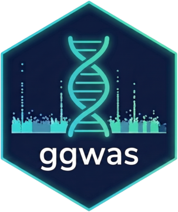
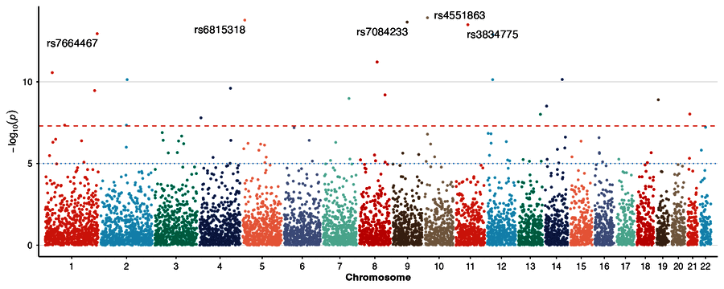
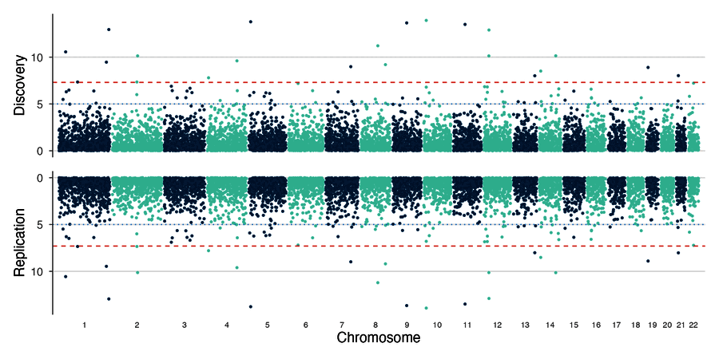
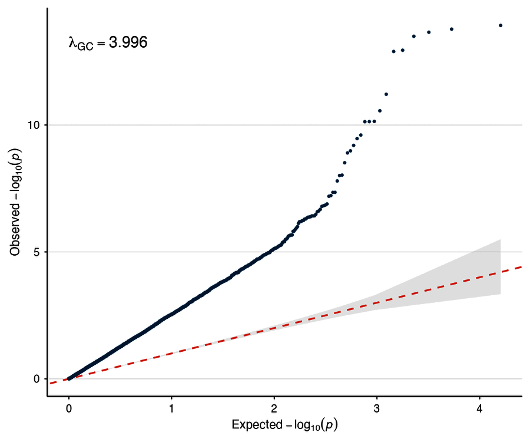
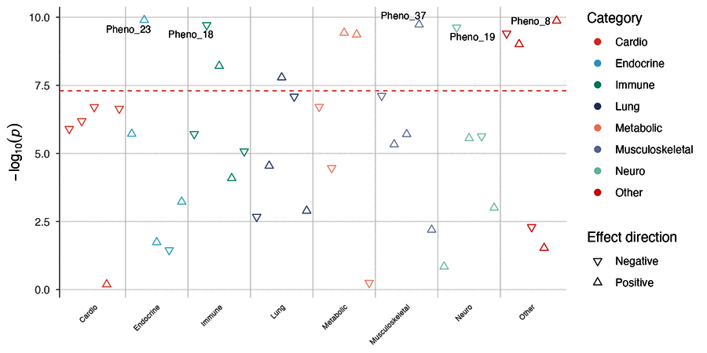
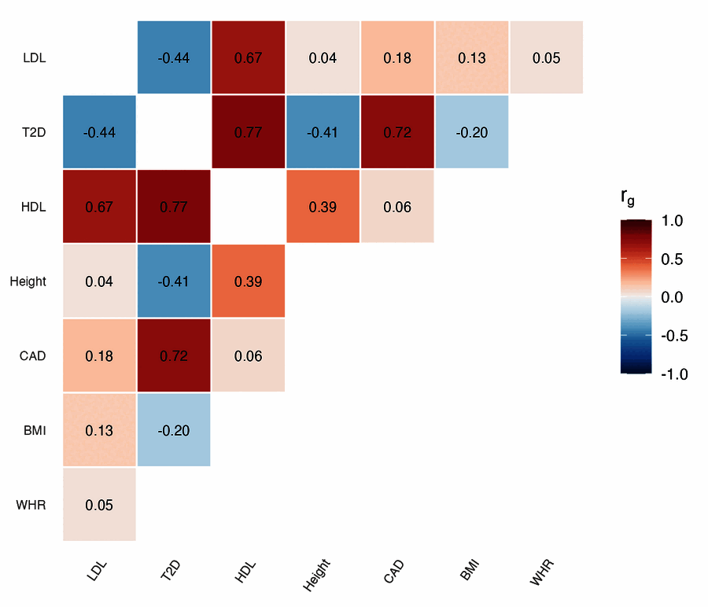
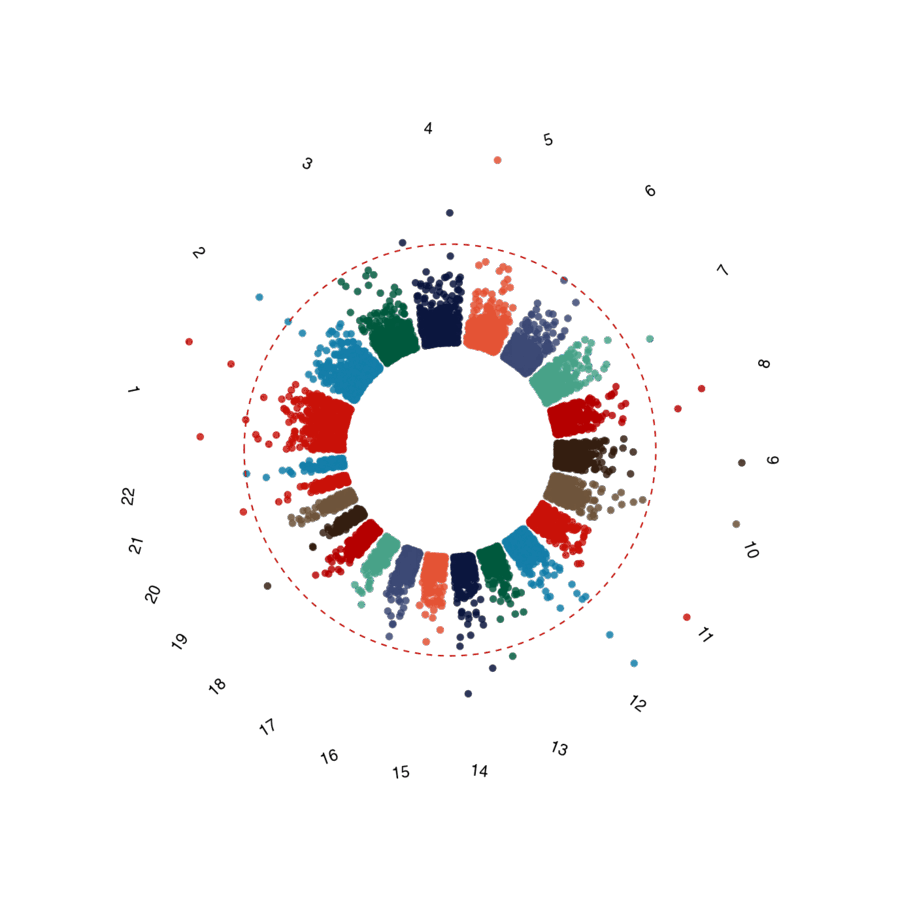

::: {.pf-lead}
I write R packages for analyses that I run often, so that other people can repeat them. All of them are open source.
:::

## ggwas

::: {.pf-software-head}
{fig-alt="ggwas logo"}

::: {}
**ggwas** draws plots for genome-wide association studies with ggplot2. It covers the usual steps from quality control to figures for a paper: Manhattan, QQ, Miami and locus zoom plots, PheWAS, fine-mapping, colocalization and genetic correlations. It includes journal themes and colour-blind-safe palettes, and it downsamples points so that biobank-sized files still plot quickly. The package is under review at Bioconductor.

::: {.pf-links}
[<i class="bi bi-github"></i> Code](https://github.com/bczech/ggwas){.pf-btn}
[<i class="bi bi-book"></i> Documentation](https://bczech.github.io/ggwas/){.pf-btn}
[<i class="bi bi-archive"></i> Zenodo DOI](https://doi.org/10.5281/zenodo.20815110){.pf-btn}
:::
:::
:::

### ggwas in a few lines

::: {.pf-code-demo}
::: {.pf-code}
```r
pak::pak("bczech/ggwas")

library(ggwas)
data(example_gwas)  # columns CHR, BP, SNP, P

manhattan_plot(example_gwas)
qq_plot(example_gwas, show_lambda = TRUE)
```
:::

::: {.pf-code-out}
{fig-alt="Manhattan plot made with ggwas"}
:::
:::

### Gallery

```{=html}
<div class="pf-gallery">
  <figure><figcaption>Manhattan plot</figcaption></figure>
  <figure><figcaption>Miami plot: two traits</figcaption></figure>
  <figure><figcaption>QQ plot</figcaption></figure>
  <figure><figcaption>PheWAS</figcaption></figure>
  <figure><figcaption>Genetic correlations</figcaption></figure>
  <figure><figcaption>Circular Manhattan plot</figcaption></figure>
</div>
```

## BRASSVis

**BRASSVis** plots gene fusions and structural variants found by [BRASS](https://github.com/cancerit/BRASS) in whole-genome sequencing data. Each fusion gets one page with chromosome ideograms, exon structure, a circos plot, retained protein domains and read support. The layout follows the [Arriba](https://github.com/suhrig/arriba) fusion plots, adapted to BRASS output.

::: {.pf-links}
[<i class="bi bi-github"></i> Code](https://github.com/bczech/BRASSVis){.pf-btn}
:::

## gDR

I contribute to [gDR](https://github.com/gdrplatform), an open-source R suite for processing and analysing drug response screens, available on Bioconductor. It processed the screens behind the papers in *Cancers* (2024) and *Nature Communications* (2025).

::: {.pf-links}
[<i class="bi bi-github"></i> gdrplatform on GitHub](https://github.com/gdrplatform){.pf-btn}
:::

## Internal tools

In pharmaceutical R&D I build R/Shiny applications for scientists and maintain production WDL pipelines for NGS data.
